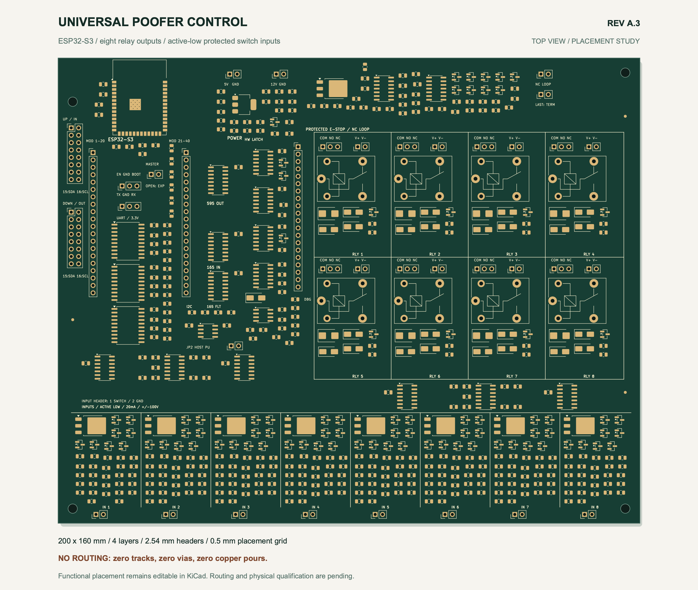
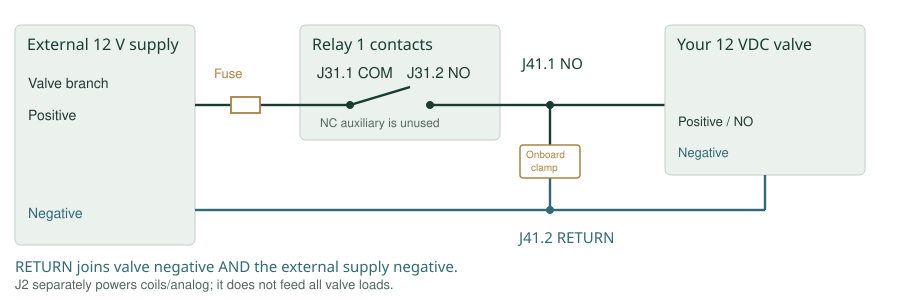
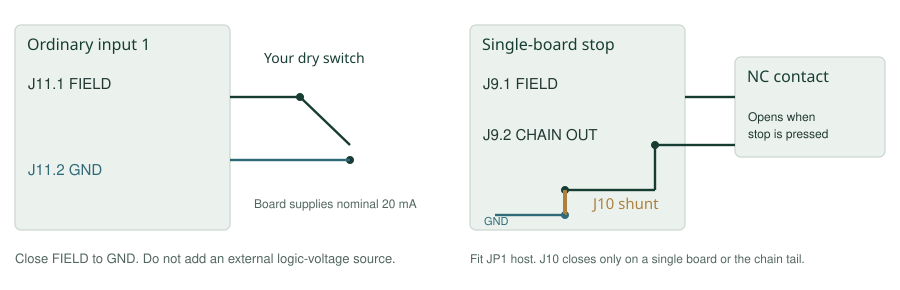
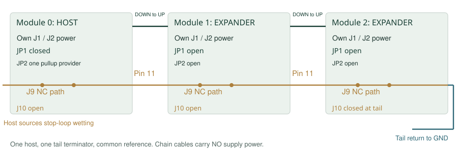

# Universal Poofer Control

Hardware User Guide

UG-A3-1.0 | Hardware A.3 | Reviewed 2026-10-03

Eight valve channels. Eight grounded-switch inputs. Buffered expansion and I2C.

**Engineering preview.** This guide describes A.3 and the supplied Arduino/PlatformIO commissioning firmware. The present PCB is an unrouted placement draft; no manufactured board has been electrically qualified. Specifications are design targets, not released product ratings. Use these operating instructions only with an assembled, qualified board whose revision and firmware match them.

This is the maintained customer-facing source of truth for documented operation. Keep it with the matching schematics, pin reference and firmware. Resolve a revision mismatch before wiring or powering a board.

## 1. Features and project ideas

Universal Poofer Control uses an ESP32-S3 to control eight 12 VDC solenoid valves through mechanical relays. It reads eight grounded switches, and forwards commands and input states through a buffered expansion chain. Hardware stop circuitry inhibits outputs independently of the application program.

| Feature | Meaning for your project |
|---|---|
| Eight NO relay outputs | Intended for 12 VDC valves, up to 1 A per channel in the A.3 design. |
| Eight active-low dry-contact inputs | Connect a switch between FIELD and GND; closed means active. |
| Nominal 20 mA wetting current | The board supplies current through each closed contact; the switch supplies no logic voltage. |
| Protected field circuitry | Continuous +100/-100 V relative to shared return is a fault-survival design target, not a normal signaling range. |
| Hardware stop/restart latch | Opening the NC loop shuts down outputs; closing it does not automatically resume them. |
| 74HC register expansion | Each module adds eight outputs and sixteen captured input bits, including fault flags. |
| I2C expansion | SDA/SCL on both chain headers, with selectable common pullups and a buffered private MCU bus. |
| ESP32-S3-WROOM-1-N8 | 8 MB flash, no PSRAM; UART programming and exposed USB signals. |
| Reworkable packages | 0805 passives, SOIC logic, larger power packages and 100 mil headers. |

The relay's 10 A resistive-contact rating does **not** make this a 10 A board. The planned application limit is 1 A per 12 V valve, with separate external fused feeds. Mains, AC valves and different load voltages are not supported by these A.3 instructions.

Choose a valve whose **deenergized fluid/pressure state is safe for your project**. Relay NO describes an electrical contact, not whether the valve is normally open or closed. Where power removal must stop flow, use an appropriate normally-closed, nonlatching valve and verify its actual behavior. Normally-open or latching valves can continue flow after their coil is unpowered; they need a separately reviewed shutdown strategy.

| Project idea | What the scaffold provides | What your application adds |
|---|---|---|
| Valve/wiring test fixture | Read contacts, pulse selected channels, exercise stop/restart. | Measurements, test logging and qualified loads. |
| Short water-dispensing or rinsing sequence | Individual timed serial pulse commands. | Sequence logic, calibrated volumes and level checks. |
| Pneumatic demonstration/test jig | Short pulses and switch-state readings. | Pressure limits, interlocks and appropriate pneumatic controls. |
| Multi-station bench fixture | Module-addressed valve commands. | Station logic, cable qualification and communication handling. |
| Sensor-equipped project | I2C bus and explicit address scan. | Peripheral drivers, unique addresses and accessory power. |

The stock firmware does not map switches to valves, run schedules, provide networking/web control, debounce contacts or configure I2C devices. Its longest command is a 1000 ms pulse, with a separately renewed 500 ms lease. Continuous-operation projects need custom application code and a reviewed control strategy. No hazardous-fluid, combustion, medical or certified machine-safety application is established by this preview.

## 2. Identify the board and connectors



This is a placement illustration, not a photograph of a released product. Match your actual board revision and silkscreen before using its positions. Keep the ESP32 antenna area clear of added metal and wiring.

This manual uses schematic references such as J1 and J11. Silkscreen may show functional names such as 5V, NC LOOP, IN 1 or RLY 1. The square pad/pin-1 mark identifies pin 1. Do not infer numbering from an arbitrary photograph or viewing direction; check continuity with power removed if uncertain.

| Reference | Function | Essential pin information |
|---|---|---|
| J1 | Logic power | 1 = regulated 5 V; 2 = GND. |
| J2 | Coil/analog power | 1 = 12 V; 2 = GND. Not the eight-valve feed. |
| J11-J18 | Inputs 1-8 | 1 = FIELD; 2 = shared GND. |
| J31-J38 | Relay contacts 1-8 | 1 = COM; 2 = NO; 3 = NC auxiliary. |
| J41-J48 | Valve connections 1-8 | 1 = switched positive/NO; 2 = external RETURN. |
| J9 | Local NC stop contact | Contact between pins 1 and 2. |
| J10 | Stop-chain terminator | Close pins 1-2 on the final board only. |
| JP1 | Hardware role | Closed = host; open = expander. |
| JP2 | Common I2C pullups | Close at one provider, normally the host. |
| J20 / J21 | Expansion | UP / DOWN; sixteen pins, no power pins. |
| J6 | Reset/boot | 1 = EN; 2 = GND; 3 = BOOT/GPIO0. |
| J7 | UART | 1 = board TX; 2 = board RX; 3 = GND; 3.3 V logic. |
| J3 / J4 | Module breakout | Physical pad order, not GPIO-number order. |
| J5 | Service/debug | Mixed power/logic; pin 9 is a high-impedance OE monitor. |

There is **no J8** in A.3. The [complete connector reference](connector-pinouts.md) lists every actual header pin. Debug pins are not alternative valve feeds or a way to bypass shutdown.

**Dry contact** means a voltage-free switch. **Active low** means the active state is low voltage. **Wetting current** is board-supplied contact current. **COM** is a relay's common contact. **NO** is open when the relay is unpowered; **NC** is closed then. **Host/module 0** drives the chain; an **expander** follows it.

## 3. Supply power and wire one valve

Disconnect power before changing wiring, jumpers or expansion cables. Start with valve loads disconnected. Have matching assembled hardware/firmware, regulated supplies, a 3.3 V UART adapter, insulated connectors, a dry switch, an NC stop contact and a meter. Fuse and size external wiring for the actual load and inrush.

| Connection | Supply target | Purpose |
|---|---|---|
| J1.1 / J1.2 | Regulated 5.0-5.25 V, at least 1 A / GND | MCU regulator, wetting sources and logic support. |
| J2.1 / J2.2 | 12 V, at least 0.5 A / GND | Relay coils and analog circuitry. |
| Each COM / RETURN | External fused 12 V / external supply negative | That valve's path; planned maximum 1 A per channel. |

Both J1 and J2 are required for normal use, including input sensing. Their grounds share the logic/input return. Do not feed 5 V into a 3.3 V pin. The UART adapter's power lead stays disconnected.



For valve 1:

1. External fused valve-supply positive to **J31.1 COM**.
2. Valve positive to **J41.1 NO**.
3. Valve negative and external supply negative to **J41.2 RETURN**, through a suitable external splice/return bus.
4. Leave **J31.3 NC auxiliary** unused for the intended valve output.

J31.2 and J41.1 are the same NO net. RETURN is **not tied to logic GND on the board**. A valve's two wires at J41 do not complete a circuit unless RETURN also reaches the external supply negative. That return connection is also necessary for the onboard valve-suppression path.

For channel n, use J(30+n) for contacts and J(40+n) for the valve. Channel 8 therefore uses J38/J48.

A suitably rated external 12 V source may power both coils and valves. Branch it outside the board: one branch to J2 and separately fused branches to COM contacts. Never carry all valve current through J2. Eight simultaneous 1 A loads plus the 0.5 A coil/analog allowance require an 8.5 A supply budget before additional margin. Sharing a source negative may join RETURN and logic GND externally; the board does not establish galvanic isolation.

## 4. Connect switches and the hardware stop



For input 1, connect a dry switch between **J11.1 FIELD** and **J11.2 GND**. Use J12-J18 for inputs 2-8. Do not connect it to an external 5 V output: the board supplies nominal 20 mA itself. FIELD is not a sensor power output.

Closed FIELD should be 0.3 V or less, including wire/contact drop. A conservative input-loop target is at most 10 ohms total contact/return resistance. Inputs share logic GND and have no galvanic isolation. Wetting current is nominal, not calibrated or a guaranteed minimum. Add application debounce before using switch transitions.

The firmware reports raw active-low `contacts_n`, separate `input_faults` and a masked `closed` bitmap. A valid closure sets its bit in `closed`: input 1 is bit 0, input 8 bit 7. Closing only input 1 gives `closed=0x01`; only input 8 gives `closed=0x80`.

### Single-board stop

Use an **NC contact that opens when the stop is pressed**. Wire it between **J9.1 ESTOP_FIELD** and **J9.2 ESTOP_CHAIN_OUT**. Fit the J10 shunt between pins 1 and 2 to complete a single-board return, and fit JP1 for host mode. Do not permanently bridge J9 as an operating substitute for a stop contact.

Opening the loop disables actual 595 output enable and removes coil power. Required-supply loss also inhibits RUN. Closing the contact or restoring power does not replay old commands: issue a fresh arm and then new pulses.

`safe_permit=1` means the local NC-loop/field receiver permits operation; it does not prove every supply is healthy. `hw_run=1` means the local RUN latch is set, not that a coil is powered, a contact has opened or a remote latch is set. It can remain 1 after software disarm while inhibit holds outputs off.

This single-channel prototype has no certified stop-time or SIL/PL rating. Coil removal cannot open a welded contact, and a short across an NC contact can bypass it. Use an appropriate independent valve-power disconnect where those failures must stop flow. Actual release depends on mechanical, magnetic and fluid behavior.

## 5. Program the board and open the console

If your board already contains matching firmware, start with its console. Otherwise install the supplied PlatformIO project with valve loads disconnected. Check the firmware version supplied with your board before proceeding.

The scaffold uses Arduino, pinned `espressif32@6.12.0` and board definition `esp32-s3-devkitc-1` for WROOM-1-N8. That toolchain name does not mean this custom board has DevKit USB/power circuitry.

| Adapter lead | Board connection |
|---|---|
| Adapter RX | J7.1, board TX / GPIO43 |
| Adapter TX | J7.2, board RX / GPIO44 |
| Adapter GND | J7.3, GND |
| Adapter power | Leave disconnected. |

Use a 3.3 V logic adapter and separately power the board. Enter the ROM loader by holding J6.3 BOOT to J6.2 GND, briefly connecting J6.1 EN to GND for reset, then releasing BOOT after download mode starts. Avoid adjacent-pin shorts.

Open `firmware/` as the PlatformIO project. In its terminal, replace PORT with the adapter port:

```sh
pio run -e poofer_uart
pio run -e poofer_uart -t upload --upload-port PORT
pio device monitor --port PORT --baud 115200 --eol LF --echo
```

Close the monitor before upload if it holds the port. Send lowercase commands, one per line, ending with LF. With JP1 fitted, reset should report **HOST DISARMED**. Reset/upload/console connection does not arm outputs.

Native USB is optional with `poofer_usb` and a suitable protected external USB interface: J3.13 is GPIO19/D-, J3.14 is GPIO20/D+. Bare headers are not a complete USB connector; USB VBUS must not feed a module/3.3 V pin. UART is the first-use path here.

The [firmware guide](../firmware/README.md) covers the isolated build environment. PlatformIO's [monitor documentation](https://docs.platformio.org/en/latest/core/userguide/device/cmd_monitor.html) describes terminal options.

## 6. First-power commissioning

For this engineering preview, qualification precedes released-product operation. On a matching assembled board, begin without valve loads:

1. Power off; check polarity, pin 1, JP1 host role, NC contact and single-board J10. Leave JP2 open unless this board must supply I2C pullups.
2. Apply J1 and J2. Wait one second for supervision/input settling.
3. Send `status`. Expect `role=host`, `armed=0`, configured count 1, `safe_permit=1` with the stop closed, and initially `hw_run=0`.
4. Open the stop; confirm permission is removed. Close it; confirm no automatic arm. A status bit alone does not prove physical contacts opened.
5. Close input 1's test switch. With other inputs open and no faults, expect `closed=0x01` on module 0. Open it and expect that bit to clear.
6. With the stop healthy, **paste these three commands as one batch**:

```text
arm
pulse 1 100
status
```

Successful arm/pulse commands each answer `ok`. A host rejection answers `rejected; outputs disarmed`; stop and diagnose it. Manual typing can exceed the 500 ms lease, hence the pasted batch. Do not append an immediate `disarm` to that batch: it cancels the pulse before the intended interval.

The request is module 0/channel 1 for 100 ms. Listen for switching and verify contact behavior with an appropriate observation method. Then send `disarm` and verify NO is open. Repeat a walking-channel test for all eight outputs. Only then connect an approved load using section 3. `outputs` is a command mask, not contact-position feedback.

### Exercise an active stop

Use a project controller or terminal macro that renews `ping` approximately every 100 ms while deliberately armed. After an acknowledged arm, request a 1000 ms pulse; open the NC stop during it and verify physical shutdown. Restoring the contact must not revive it. Finish with disarm. Repeat for each used channel/module. Without an automated lease-renewal sender, do not assume a hand-typed 1000 ms pulse lasts a full second.

Commissioning must measure real stop time, load suppression, supply-loss behavior and physical release, including the system's independent disconnect where required. These first-use steps do not replace release qualification.

## 7. Commands, timing and status

| Command | Meaning |
|---|---|
| `status` | Role/safety, then host per-module data; no lease renewal. |
| `arm` | Explicit healthy-host arm after zeroing storage; opens no valve. |
| `disarm` | Inhibit and clear commands. |
| `ping` | Renew an already-armed lease; does not arm. |
| `pulse 1 100` | Module 0/channel 1 for 100 ms; channels are 1-8. |
| `pulse 2 1 100` | Module 2/channel 1; needs at least three configured boards. |
| `i2cscan` | Explicit address scan while disarmed, on host only. |

Arm requires at least 50 ms of healthy loop permission, plus valid supplies after the hardware's approximately 200 ms startup supervision. The one-second first-use wait covers these initial settling intervals.

Pulses are 1-1000 ms, but a session expires **500 ms after its last accepted arm, ping or pulse**. A full 1000 ms pulse requires accepted pings before expiry. Your application generates keepalives; status is not one. Timing is a main-loop deadline, not a precision/safety timer.

The scaffold does not extend an active pulse. Re-arming while armed, pinging while disarmed, pulsing an active channel, scanning while armed, invalid arguments or an overlong line can reject and disarm. Check replies. Stop/power-loss recovery requires a fresh arm and new pulse, never automatic replay.

| Field | Interpretation |
|---|---|
| `role` | Match physical JP1 and reset configuration. |
| `armed` | Firmware session, not a physical valve state. |
| `safe_permit` | Local NC/field permission, not complete power health. |
| `hw_run` | Local hardware latch, not remote/contact feedback. |
| `estop_latched` / `hw_fault_latched` | Remembered stop or failed hardware arm; resolve before rearming. |
| `needs_reset` | Role change needs reset before host initialization. |
| `contacts_n` | Raw byte; a 0 bit indicates sensed closure. |
| `input_faults` | A 1 bit indicates an asserted negative-fault detector. |
| `closed` | `(~contacts_n) & (~input_faults)`; usable closures. |
| `outputs` | Commanded pulses; a 1 bit is a request. |
| `last_stop` | Reason such as manual, estop, hardware_inhibit or lease_expired. |

Expander console firmware is read-only and does not report the host-controlled stream as its own data. Modules start at 0; channels start at 1.

## 8. Add expansion boards

Power off and disarm before configuration. Connect host **J21 DOWN** to the next **J20 UP** pin-for-pin, then repeat DOWN-to-UP. Check orientation and every cable's continuity. Provide each module's own J1/J2 connections and common reference; no power travels in the chain cable. Do not parallel regulator outputs.



| Three-board setup | Host / 0 | Expander / 1 | Expander / 2 |
|---|---|---|---|
| JP1 | Closed | Open | Open |
| JP2 | Closed only if pullup provider | Open | Open |
| J10 | Open | Open | Closed |
| J9 | NC contact or qualified continuity | NC contact or qualified continuity | NC contact or qualified continuity |
| Power | Own J1/J2 | Own J1/J2 | Own J1/J2 |

The safety path is host J9 contact, DOWN pin 11, next UP pin 11, next J9, and so on to final J10. The host supplies nominal 20 mA to this **series loop**. Keep all contacts/connectors/wiring at or below 10 ohms total as a conservative target, not 10 ohms per contact. An unused J9 still needs an intentional continuity decision; do not shunt a required stop location.

Fit exactly one host JP1 and one tail J10. An intermediate J10 can bypass downstream stops. A disconnect inhibits downstream receivers; the correctly wired series loop also stops the host. A local supply fault inhibits that board and downstream, not inherently upstream valves. Global NC stopping depends on the full loop.

Set host `BOARD_CHAIN_MODULES` to the actual total, including module 0. For three boards add `-D BOARD_CHAIN_MODULES=3` to the selected environment's existing build flags, preserve the other flags, rebuild and upload the host. Allocation is 1-32 boards; discovery is not automatic. Sending arm to an expander does not grant bus control.

Each board adds eight outputs/sixteen input bits. Host reads ascending modules and writes farthest-first. Missing modules return HIGH fault bits and are masked. Qualify cable length, edges, grounds, propagation and resistance for your installation. Further expansion is possible through the protocol; unlimited distance/count is not established.

## 9. I2C peripherals

On both **J20/J21**, **pin 15 is SDA** and **pin 16 is SCL**. Use a GND pin on that header. Default operation is 3.3 V / 100 kHz. Supply peripheral power separately; these headers contain no power pin.

PCA9517A buffers the common external A bus onto private MCU B buses. Private GPIO8/SDA and GPIO9/SCL are J3.12/J3.17; they are not interchangeable with common pins when arranging a multi-board bus. Shared ground and powered-off buffering are not galvanic isolation.

JP2 enables a 2.2 kohm common pullup pair, normally on the host alone. Coordinate other modules' pullups; parallel pairs change current/rise time. Private buses have 4.7 kohm pullups. Peripherals need unique addresses. Scaffold expanders do not advertise I2C slave addresses.

While disarmed, send `i2cscan`. Replies include `i2c_found=0xNN` and a completion/error summary. It probes 0x08-0x77, sends no register/data bytes, and aborts on unexpected bus errors. Devices must permit address probing. Scanning does not configure devices or map sensors to valves.

Qualify the entire common bus at no more than **400 pF** for the planned 100 kHz setup, including LOW levels/rise time. Thirty-two ports can consume 224 pF before cable. I2C address/loading limits differ from shift-chain allocation. See the [I2C review](i2c-interface-review.md).

## 10. Read and navigate the schematics

Use the matching PDF without KiCad. For editable drawings, install KiCad 10, open **Universal_Poofer_Control.kicad_pro**, then the root schematic. Keep child sheets, Poofer.kicad_sym, Poofer.pretty and library tables together. See [KiCad's official guide](https://docs.kicad.org/10.0/en/getting_started_in_kicad/getting_started_in_kicad.html).

Start on page 01, then use the hierarchy navigator or PDF numbers. A symbol depicts electrical function, not connector orientation. The schematic defines connections; the PCB shows placement. The current PCB has no routed copper and is not a fabrication file.

| Page | Find here |
|---|---|
| 01 | System overview/contracts. |
| 02 | ESP32, reset/boot, UART, breakouts. |
| 03 | Power inputs, regulator, supervision, references. |
| 04 | U3 output 595; U4/U5 contact/fault 165 registers. |
| 05 | UP/DOWN, physical role, buffers. |
| 06 | RUN latch, actual inhibit, coil cutoff. |
| 07-10 | Contact/fault receivers, two channels per page. |
| 11-14 | Wetting sources/negative-fault clamps. |
| 15 | NC stop source/receiver, local contact, termination. |
| 16-17 | Relays, contact/valve headers, suppression. |
| 18 | Analog supplies, bypasses, spare units, J5. |
| 19 | Logic supplies/spares, protected OE monitor. |
| 20 | Buffered shared current reference. |
| 21 | I2C buffering and JP2. |
| 22 | BUS/UP/MCU defaults and buffer bypasses. |
| 23 | Raw-supply monitors and rail bleeds. |
| 24 | Filtered emitter feedback for each source. |

For input 1, follow **J11.1 / IN1_FIELD** on page 07 to **IN1_N / IN1_FAULT**, then page 04's registers. Wetting is on page 11, feedback on page 24. Matching global net labels connect pages without a drawn cross-page wire.

For valve 1, follow **RLY1_CMD** from U3/page 04 to Q1/K1/page 16, then COM/NO and J31/J41. **+12V_COIL_SAFE** originates at page 06's hardware gate. A command bit cannot energize the relay while that gate has removed coil power.

R/C/D/Q/U/K/J references mean resistor/capacitor/diode/transistor/IC/relay/connector. U20A is a unit of a multi-unit chip; its supply unit may be elsewhere. Dots mark joins; crossings alone do not prove connections. `_N` conventionally means active low. Symbol properties contain exact parts/footprints; editing a printed value alone is not a reviewed substitution.

## 11. Build your application

| Function | GPIO | Header access |
|---|---:|---|
| Clock / output serial / input serial | 6 / 4 / 5 | J3.6 / J3.4 / J3.5 |
| Latch | 7 | J3.7 |
| MCU inhibit, HIGH disables | 15 | J3.8 |
| Clear / parallel load | 16 / 17 | J3.9 / J3.11 |
| Protected loop permission | 18 | J3.10 |
| Protected local RUN | 21 | J4.3 |
| Physical role monitor | 2 | J4.18 |
| Private SDA / SCL | 8 / 9 | J3.12 / J3.17 |

Do not confuse GPIO, module pad and header pin numbers. GPIO21 is module pad 23 and J4.3; J3.8 is GPIO15, not GPIO8. J3 pins 1-20 follow module pads 1-20; J4 pins 1-20 follow pads 21-40. Pad 41 is grounded on the PCB. GPIO0/3/45/46 are boot straps; preserve their reset levels. The complete pin reference lists every breakout.

Keep stop/role hardware independent. Initialize inhibited, clear/latch zero, require explicit arm with healthy feedback, and never automatically re-arm after a stop. Preserve fault masking, add debounce/interlocks and budget peripheral/radio current against supply and thermal limits. Built-in ESP32 capabilities do not mean the scaffold implements networking or communication authorization.

Input clocks also shift the 595 internally: keep its output latch LOW while reading inputs and commit complete frames. `/SRCLR` does not clear the storage latch. Follow the tested driver rather than assuming default SPI sampling preserves the first Q7 bit.

## 12. Troubleshooting and care

| Symptom | Check |
|---|---|
| No console | Port/115200, crossed TX/RX, GND, both supplies, reset and installed firmware. |
| Expander message | JP1 absent or role changed; configure powered off, reset. |
| Arm rejected | Role, settled NC permission, supplies and startup; a second arm while armed also rejects. |
| Pulse rejected | Lease expired, wrong index, active pulse or preceding rejected command. Use the pasted batch. |
| Pulse shorter than 1000 ms | No accepted ping before 500 ms lease expiry; status is not keepalive. |
| RUN high, valve off | No pulse, manual inhibit, missing COM/RETURN, fuse or load; RUN is not contact feedback. |
| Wrong switch state | FIELD-to-GND, channel, resistance/return and input_faults; check pin vs GPIO. |
| Expansion inputs masked | Count, power, orientation, return stream, physical role; missing modules return faults. |
| Downstream stop ineffective | Intermediate J10 or wrong J9 continuity; verify full series loop. |
| No I2C devices | Disarmed host, device power/GND, pins15/16, compatible probe, pullups/loading. |
| No automatic recovery | Expected: resolve fault, fresh arm, new pulse. |

Isolate power before service. Substitute parts only after reviewing voltage, package, pinout and thermal equivalence. Reworkable size does not make parts interchangeable. Keep exposed headers from bridging chassis/neighboring pins and keep metal away from the antenna.

The +100/-100 V target is not a customer test instruction. Full-temperature endurance, disconnected-rail behavior, regulatory compliance and stop-time qualification remain pending. ESD/surge, faults on shared return/non-FIELD pins and intermediate-voltage diagnostic interpretation are separate issues. Use the approved release specifications when available.

When contacting your supplier, record hardware/guide/firmware versions, module count, supply voltages, jumpers, cable/load details, exact commands/replies and status. Use the support contact and warranty terms provided with your purchase.

## Document control and references

| File | Role |
|---|---|
| docs/hardware-user-guide.md | Canonical editable customer operation guide. |
| output/pdf/Universal_Poofer_Control_Hardware_User_Guide.pdf | Printable derivative of this source. |
| docs/connector-pinouts.md | Every actual connector net. |
| Universal_Poofer_Control.kicad_pro and linked sheets | Editable design and libraries. |
| output/pdf/Universal_Poofer_Control_A3.pdf | Matching 24-page schematic. |
| firmware/README.md and include/board_pins.h | Build/configuration and pin contract. |
| docs/hardware-design-review-A3.md | Engineering evidence and release limits. |

UG-A3-1.0 is the first purchaser-oriented guide for A.3 and the commissioning scaffold. Review it whenever interfaces, firmware, limits, qualification, jumpers or supported uses change. A mismatch is a release issue to resolve, not an invitation to try alternative wiring while powered.
